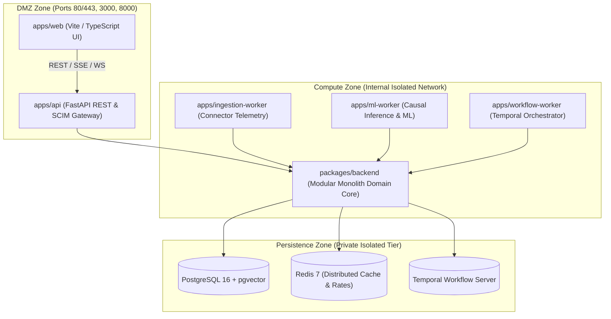

# RevPilot AI

<div align="center">

[](https://github.com/DuongVinh2004/RevPilot-AI/releases)
[](https://github.com/DuongVinh2004/RevPilot-AI/actions/workflows/ci.yml)
[](https://github.com/DuongVinh2004/RevPilot-AI/actions/workflows/codeql.yml)
[](tests/)
[](LICENSE)
[](pyproject.toml)
[](package.json)
[](https://github.com/astral-sh/ruff)
[](https://github.com/python/mypy)
[](CONTRIBUTING.md)

**Enterprise-Grade Autonomous Revenue Intelligence & Action Platform for RevOps**

*Causal AI Inference • Multi-Agent Ticket Investigation • Cryptographic Human-in-the-Loop Execution*

[Quick Start](#quick-start-local-development) • [Architecture](#system-architecture) • [Invariants](#architectural-invariants-non-negotiable) • [Documentation](#documentation) • [Releases](https://github.com/DuongVinh2004/RevPilot-AI/releases)

---

</div>

## Table of Contents

- [Overview](#overview)
- [Key Capabilities](#key-capabilities)
- [The 9-Stage Product Lifecycle](#the-9-stage-product-lifecycle)
- [Architectural Invariants (Non-Negotiable)](#architectural-invariants-non-negotiable)
- [System Architecture](#system-architecture)
- [Repository Topology](#repository-topology)
- [Quick Start (Local Development)](#quick-start-local-development)
  - [Prerequisites](#prerequisites)
  - [1. Launch Platform via Docker Compose](#1-launch-platform-via-docker-compose)
  - [2. Run Automated Verification Suite](#2-run-automated-verification-suite)
  - [3. Code Quality & Type Safety](#3-code-quality--type-safety)
- [Documentation & Specifications](#documentation--specifications)
- [Community & Governance](#community--governance)
- [Citation](#citation)
- [License](#license)

---

## Overview

**RevPilot AI** is an enterprise-grade Autonomous Revenue Intelligence & Action Platform engineered specifically for Revenue Operations (RevOps). It bridges the critical gap between revenue analytics and autonomous execution by mathematically bounding agent behavior through causal discovery, anti-hallucination grounders, and cryptographic human approval gates.

Traditional RevOps tooling alerts operators to metric drops after revenue has already decayed. RevPilot AI couples continuous real-time anomaly localization with causal inference, generates auditable evidence provenance graphs, formulates budget-bounded intervention policies, and requires cryptographically signed human approval before executing any mutating operational action.

---

## Key Capabilities

| Capability | Technical Mechanism | Benefit |
| :--- | :--- | :--- |
| **Metric Anomaly Localization** | Robust Z-Score, Isolation Forest & seasonal decomposition | Zero-lag detection of ARR decay, churn spikes, and pipeline leakage |
| **Causal AI & Uplift Modeling** | Do-calculus, DAG causal discovery & counterfactual estimators | Distinguishes root causes from statistical noise and spurious correlations |
| **Multi-Agent Investigation** | Autonomous ticket reasoning & Evidence Provenance Graphs | Synthesizes logs, telemetry, and CRM tickets into an auditable evidence chain |
| **Anti-Hallucination Grounder** | Formal constraint verifier with fail-closed rejection | Guarantees zero unsupported claims reach executive decision-makers |
| **Budget-Bounded Policy Engine** | Constraint satisfaction solver with financial blast-radius limits | Optimizes RevOps policies under strict cost and risk boundaries |
| **Human-in-the-Loop Gates** | Cryptographic HMAC-SHA256 tokens & audit ledger | Absolute enforcement of zero agent self-approval (`INV-ACT-003`) |
| **Multi-Tenant Isolation** | Server-derived cryptographic tenant scoping & schema isolation | Enterprise multi-tenancy compliant with SOC2 and GDPR |

---

## The 9-Stage Product Lifecycle

```
DETECT ──> INVESTIGATE ──> REASON ──> VERIFY ──> DECIDE ──> APPROVE ──> ACT ──> MEASURE ──> LEARN
```

1. **DETECT**: Anomaly localization and time-series metric deviation tracking (`analytics`).
2. **INVESTIGATE**: Autonomous ticket and multi-modal investigation with evidence provenance DAGs (`investigation`).
3. **REASON**: Causal discovery and counterfactual uplift modeling via Do-calculus (`causal`).
4. **VERIFY**: Anti-hallucination verification grounder preventing unsupported claims (`verifier`).
5. **DECIDE**: Constraint satisfaction and budget-bounded policy selection (`decision`).
6. **APPROVE**: Cryptographically signed human approval gate (`HMAC-SHA256`) for tier-1..3 mutations (`approval`).
7. **ACT**: Idempotent tool execution gateway with rate limiters and blast-radius bounding (`action`).
8. **MEASURE & LEARN**: Observability feedback, continuous calibration, and audit logging (`finops`).

---

## Architectural Invariants (Non-Negotiable)

Every component, background worker, and pull request in RevPilot AI must strictly enforce our canonical invariants:

- **Zero Agent Self-Approval ([INV-ACT-003](docs/03-requirements/INVARIANT-REGISTRY.md))**: No AI agent, LLM, or background service may approve its own actions. Tier-1..3 mutating operations require an authenticated human approval token.
- **Fail-Closed Execution ([INV-SEC-001](docs/03-requirements/INVARIANT-REGISTRY.md))**: Missing tokens, unverified claims, network partitions, or ambiguous tenant headers immediately fail closed (FAIL_CLOSED).
- **Strict Multi-Tenant Isolation ([INV-TEN-001](docs/03-requirements/INVARIANT-REGISTRY.md))**: Tenant context is server-derived from cryptographic credentials. Zero cross-tenant data leaks in databases, Redis caches, or vector indexes.
- **Anti-Fabrication Invariant ([AC-014](execution/FLASH-EXECUTOR-RULEBOOK.md))**: Benchmark scores, uplift estimates, and test outputs must originate from verifiable machine logs. Mocked or hallucinated scores are strictly prohibited.
- **Audit Immutability ([INV-AUD-001](docs/03-requirements/INVARIANT-REGISTRY.md))**: Every state mutation, decision rationale, and tool execution is permanently sealed in an append-only cryptographic audit log.

---

## System Architecture



---

## Repository Topology

```
.
├── .github/                 # Workflows (CI, CodeQL, Release), issue & PR templates, CODEOWNERS
├── apps/
│   ├── api/                 # FastAPI REST, SCIM Gateway, Auth & Audit Middleware
│   ├── web/                 # TypeScript/Vite UI (Anomaly Dashboard, Approval Center)
│   ├── ingestion-worker/    # High-throughput SaaS & metric data connector worker
│   ├── ml-worker/           # Causal inference and model evaluation worker
│   └── workflow-worker/     # Temporal durable execution worker
├── packages/
│   └── backend/             # Core modular monolith domain services & adapters
│       ├── alembic/         # 13 migration versions covering full enterprise schema
│       └── src/revpilot/
│           ├── infrastructure/  # Database pooling, Redis cache, pgvector setup
│           └── modules/         # Anomaly, Causal, Decision, Approval, Verifier, Safety
├── docs/                    # Complete architectural specifications (ADRs, NFRs, Security)
├── execution/               # Execution queues, roadmap, and rail control
├── infra/                   # Infrastructure configuration, Docker, Terraform modules
├── tasks/                   # Canonical micro-task specifications and acceptance criteria
└── tests/                   # 550+ automated unit, integration, and security tests
```

---

## Quick Start (Local Development)

### Prerequisites
- [Docker](https://docs.docker.com/get-docker/) & Docker Compose v2+
- Python 3.12+
- Node.js 20+

### 1. Launch Platform via Docker Compose

Spin up the complete 3-zone defense-in-depth platform with one command:

```bash
docker compose up -d
```

| Service | Address | Description |
| :--- | :--- | :--- |
| **Web Dashboard** | [http://localhost:3000](http://localhost:3000) | Anomaly Dashboard, Approval Center & Evidence DAGs |
| **API Swagger Docs**| [http://localhost:8000/docs](http://localhost:8000/docs) | Interactive REST API documentation & OpenAPI schema |
| **Temporal UI** | [http://localhost:8088](http://localhost:8088) | Durable workflow execution monitoring |

### 2. Run Automated Verification Suite

RevPilot AI includes over 550 automated unit, integration, and security tests:

```bash
# Create and activate virtual environment
python -m venv .venv
source .venv/bin/activate  # On Windows: .venv\Scripts\activate

# Install dependencies in editable mode
pip install -e ".[dev]"

# Run full automated test suite
python -m pytest tests/ packages/backend/tests/ -v
```

### 3. Code Quality & Type Safety

```bash
# Code formatting & linting with Ruff
ruff check .

# Strict static type checking with Mypy
mypy packages/backend/src apps/api
```

---

## Documentation & Specifications

Full architectural specifications and formal decision records are maintained in `docs/`:

- [SPECIFICATION-PRECEDENCE.md](docs/00-executive/SPECIFICATION-PRECEDENCE.md) — Precedence hierarchy and closure rules
- [INVARIANT-REGISTRY.md](docs/03-requirements/INVARIANT-REGISTRY.md) — Canonical platform invariants
- [SECURITY-ARCHITECTURE.md](docs/15-security/SECURITY-ARCHITECTURE.md) — Defense-in-depth security model & threat boundaries
- [Architecture Decision Records (ADRs)](docs/31-adr/) — ADR-0001 through ADR-0012
- [Database Schema Specification](docs/27-database/DATABASE-SCHEMA.md) — Multi-tenant schema design

---

## Community & Governance

We maintain strict open-source governance and security standards:

- **Contributing**: Please read our [Contributing Guide](CONTRIBUTING.md) for commit standards, invariant verification, and pull request workflows.
- **Code Ownership**: Component maintainers and critical boundary reviewers are defined in [.github/CODEOWNERS](.github/CODEOWNERS).
- **Code of Conduct**: All participants must abide by our [Code of Conduct](CODE_OF_CONDUCT.md).
- **Security Policy**: To report vulnerabilities, follow our private disclosure process in [SECURITY.md](SECURITY.md).

---

## Citation

If you use RevPilot AI in research, enterprise architectures, or benchmarks, please cite this project using the metadata in [CITATION.cff](CITATION.cff):

```bibtex
@software{RevPilot_AI_2026,
  author = {Duong, Vinh},
  title = {RevPilot AI: Autonomous Revenue Intelligence & Action Platform for Enterprise RevOps},
  url = {https://github.com/DuongVinh2004/RevPilot-AI},
  version = {1.0.0},
  year = {2026}
}
```

---

## License

RevPilot AI is open-source software licensed under the [Apache License, Version 2.0](LICENSE).
